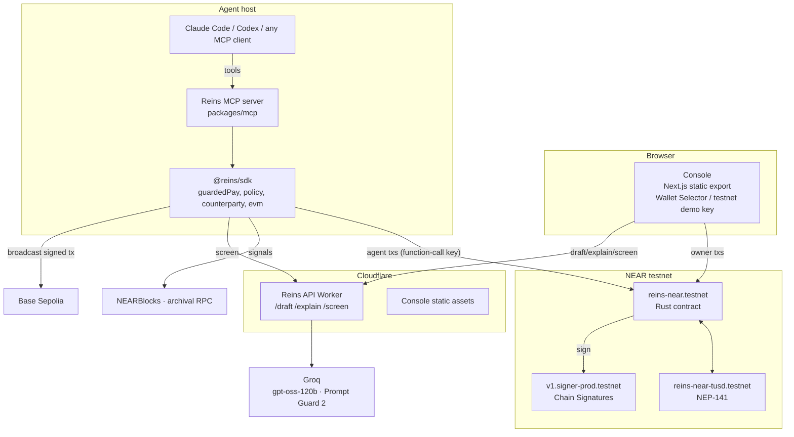
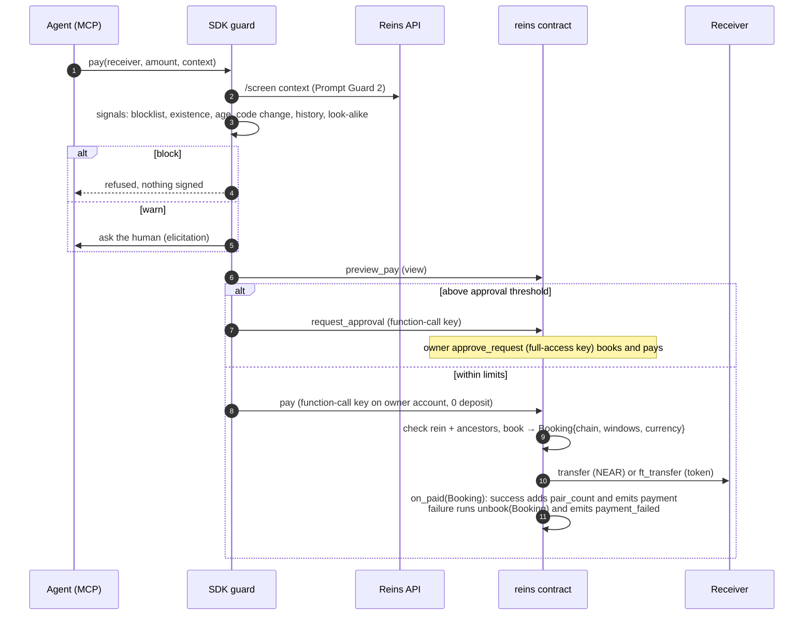
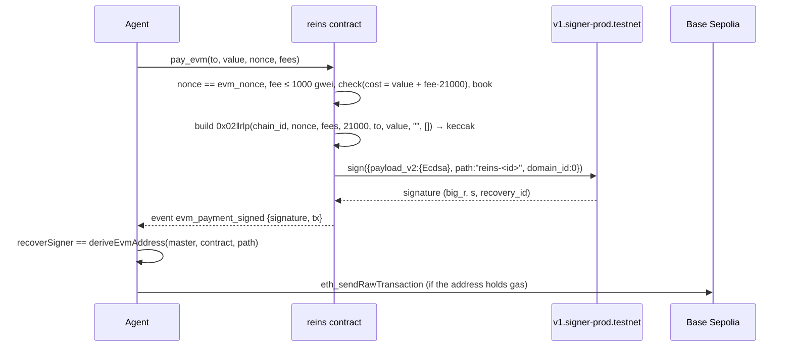

# Architecture

## Components

| Component | Path | Runs on | Holds keys? |
| --- | --- | --- | --- |
| Contract | `contracts/reins` | NEAR testnet `reins-near.testnet` | no |
| Test stablecoin | `contracts/test-token` | `reins-near-tusd.testnet` | no |
| SDK | `packages/sdk` | agent host, browser, scripts | caller's |
| MCP server | `packages/mcp` | agent host (stdio) | agent's function-call key (env) |
| API | `packages/api` | Cloudflare Worker `reins-api` | Groq key as Worker secret |
| Console | `packages/dashboard` | Cloudflare Workers static assets `reins` | none server-side |
| Scripts | `scripts/` | developer machine | `~/.near-credentials` |

## Contract modules

| File | Responsibility |
| --- | --- |
| `lib.rs` | state (`LookupMap`s for reins, key index, vaults, token vaults, requests, reports, overrides, pair counts), init, storage accounting (`charge_storage` flushes collections first) |
| `types.rs` | `Terms`, `Rein`, `PayRequest`, `Report`, `Preview`, `Booking` |
| `guard.rs` | `check` (all rules along the rein chain), `book`, `unbook` |
| `owner.rs` | owner methods behind `full_access_owner` (≥ 1 yocto), `insert_rein`, subtree status, `send` |
| `agent.rs` | `caller_rein` lookup, `pay`, `request_approval`, `issue_subrein`, `on_paid` |
| `tokens.rs` | `register_token`, `ft_on_transfer`, `withdraw_token`, `ft_transfer` helper |
| `evm.rs` | RLP + EIP-1559 builder, `pay_evm`, `on_signed`, derivation path |
| `views.rs` | read-only methods incl. `preview_pay` |
| `events.rs` / `errors.rs` | NEP-297 emitter; stable error codes |

## Transaction lifecycle: a NEAR payment

## Transaction lifecycle: a Chain Signatures payment

## The owner/agent boundary

The agent key is a NEAR **function-call access key** on the owner's account (or a named sub-account of it),
limited to `pay`, `pay_evm`, `request_approval`, `issue_subrein` on the Reins contract, with a gas allowance.
NEAR does not let such a key attach a deposit; every owner method requires ≥ 1 yoctoNEAR. So the boundary is
enforced by the protocol and the contract together, not by server code. Details in [SECURITY.md](SECURITY.md).

## State and storage

- All collections are `near_sdk::store::LookupMap`; payment history is not stored, only emitted as events.
- Storage added by any call, including agent calls, is charged to the owner's vault (`charge_storage`), never
  the contract's balance; token vaults must be registered by the owner first.
- Bounds: 32 live / 128 total reins per owner, 8 children, depth 3, 4 open requests per rein, 16 reports per
  account, 16 merchants, 64-char labels, 128-char memos.

## Scalability

- Each rein is O(1) storage: under 1 KB (the test `storage_is_charged_to_the_vault` asserts creation costs < 0.01 NEAR); a payment touches at most 3 reins (depth bound), so gas per payment is
  constant. NEAR shards by account, and the contract has no global loops in the payment path.
- The API Worker is stateless and runs at the edge; the console is static.
- One deployment serves any number of owners; owners do not need their own contract.
