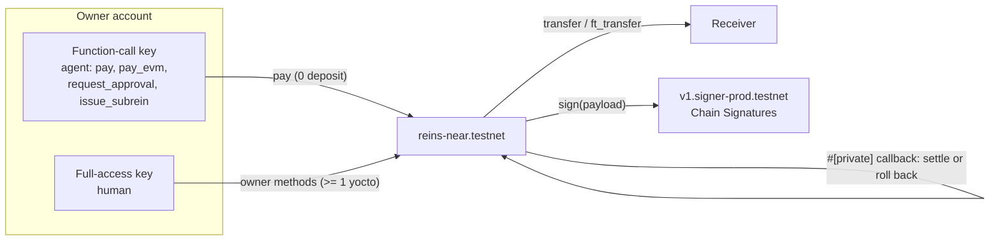

# Security

Reins moves money on behalf of AI agents, so its security model is the product. This document covers the
architecture, threat model, the internal audit we ran on 2026-11-14, every finding with its fix, and the risks
that remain.

> **Status, stated plainly.** Reins has had an **internal review only**: automated checks (rustfmt, clippy with
> `-D warnings`, 75 unit tests, CI secret scanning and dependency audit) plus a manual line-by-line review by a
> separate reviewer instance. It has **not** had an independent third-party audit, and it is deployed on
> **testnet only**. Do not put real funds in it.

**Reporting a vulnerability:** open a private advisory at
<https://github.com/LSUDOKO/Reins/security/advisories/new>. Please do not file public issues for security bugs.

---

## 1. What is protected

| Asset | Where it lives | Who may move it |
| --- | --- | --- |
| Owner's NEAR | `vaults[owner]` inside `reins-near.testnet` | owner (full-access key) via `withdraw`; agents only through `pay` inside a rein |
| Owner's NEP-141 tokens | `token_vaults[owner\|token]` | owner via `withdraw_token`; agents through `pay` on a token rein |
| Funds on another chain | EVM address derived by NEAR Chain Signatures from (`reins-near.testnet`, `reins-<id>`) | only transactions the contract builds and the MPC network signs inside the rein |
| Rein terms | `reins[id]` | owner only (`update_terms`, `freeze`, `revoke`, …) |
| Blocklist integrity | `reports[account]` | any account, bonded; each owner can override for their own reins |
| Agent credential | a function-call access key on the owner's account (or a named sub-account) | held by the agent; revocable by the owner |

## 2. Security architecture

Four independent layers stop a compromised agent:

1. **NEAR runtime.** A function-call key can call only the listed methods on the listed contract and **cannot
   attach a deposit**. It cannot transfer NEAR, add keys, deploy, or call another contract.
2. **The owner/agent boundary in the contract.** Every owner method requires `attached_deposit >= 1 yoctoNEAR`
   (`owner.rs` `full_access_owner`), which only a full-access key can supply, even if an agent key were wrongly
   granted every method name.
3. **The rein rules.** `guard.rs` `check` runs on the rein *and every ancestor*: status, expiry, use count,
   merchant allowlist, per-payment cap, budget window, approval threshold, shared blocklist, vault balance.
   `preview_pay` returns the same code without signing anything.
4. **The agent-side guard** (`packages/sdk/src/agent.ts` `guardedPay`, used by the MCP server). It screens the
   receiver (blocklist, existence, account age, contract-code changes, payment history, look-alike names) and the
   text that triggered the payment (Llama Prompt Guard 2). Block means never sign; warn means ask the human.
   This layer is **advisory**: the contract enforces everything that matters even if the guard is bypassed, which
   `scripts/attack.ts` demonstrates with `rawPay`.

## 3. Threat model

| Attacker | Capability | Goal |
| --- | --- | --- |
| Prompt-injected or malicious **agent** | holds one function-call key; can call `pay`, `pay_evm`, `request_approval`, `issue_subrein` with any arguments, any number of times, from any rein it holds | drain the owner, exceed limits, pay a scammer, escalate to owner powers, grief storage |
| **Stranger** | any NEAR account, any method, any deposit | steal pooled funds, mint vault balance, block merchants, grief storage |
| **Malicious token / receiver contract** | controls `ft_transfer` / receive behaviour, can fail or delay callbacks | mint vault balance through rollbacks |
| **Malicious merchant** | can register look-alike accounts, change contract code | get paid by mistake |
| **Compromised guard API** | returns wrong verdicts | make the agent-side guard allow a bad payment |

Trust assumptions:
- the NEAR protocol enforces access-key permissions;
- the Chain Signatures MPC network signs only what it is asked, and its signatures are correct;
- the owner keeps their full-access key safe (Reins cannot protect a stolen owner key);
- the Groq-backed guard and NEARBlocks are untrusted inputs: they can only *add* caution, never relax a contract
  rule.

Attack surface: every public contract method (agent, owner, `ft_on_transfer`, `report`, views), the two
`#[private]` callbacks (`on_paid`, `on_signed`), the API Worker (`/draft`, `/explain`, `/screen`), and the
browser console (static site, no server-side keys).

## 4. Methodology and tools

| Kind | What | Result |
| --- | --- | --- |
| Automated | `cargo fmt --check` | clean |
| Automated | `cargo clippy -p reins --target wasm32-unknown-unknown -- -D warnings` | 0 warnings ([tests/results/clippy.txt](tests/results/clippy.txt)) |
| Automated | `cargo test -p reins`: 75 unit tests incl. 12 audit regression tests | 75 passed ([tests/results/contract.txt](tests/results/contract.txt)) |
| Automated | TypeScript strict typecheck + 45 JS tests (SDK, MCP, API, console logic) | pass ([tests/results/js.txt](tests/results/js.txt)) |
| Automated (CI) | gitleaks secret scan on full history; `cargo audit` | runs on every push ([.github/workflows/ci.yml](.github/workflows/ci.yml)) |
| Manual | line-by-line review of every contract module by a separate reviewer instance, against the threat model above | 13 findings, below |
| Live adversarial | `scripts/attack.ts`: injected agent tries 8 attacks on testnet | all 8 stopped ([demo/logs/attack.log](demo/logs/attack.log)) |
| Live | `scripts/verify.ts`: re-checks every recorded transaction's event or revert against the RPC | 20/20 ([tests/results/verify.txt](tests/results/verify.txt)) |

Overflow: the release profile sets `overflow-checks = true`; arithmetic panics instead of wrapping, window and
expiry math is saturating.

## 5. Findings and fixes

Each fixed finding except L-5 has a regression test named `audit_<id>_…` in `contracts/reins/src/tests.rs`.

| ID | Severity | Finding | Fix | Status |
| --- | --- | --- | --- | --- |
| C-1 | Critical | `request_approval` / `approve_request` accepted **EVM reins**. `check` skipped the vault for EVM reins and `send` then transferred **NEAR from the shared pool** without debiting anyone: an attacker could create an EVM rein with `approval_above: 0` and approve a payout of the whole contract balance | `request_approval` and `approve_request` reject EVM reins; `send` asserts the booking is not EVM | **Fixed** (`agent.rs`, `owner.rs`); tests `audit_c1_*` |
| C-2 | Critical | `update_terms` could change a rein's **currency** while a payment was in flight; `unbook` refunded into the *current* currency, so a failed 1e30-unit fake-token payment could be refunded as 1e30 yoctoNEAR | Currency (`token`, `evm_chain_id`) is immutable after creation; the `Booking` (chain, windows, token, evm flag) travels to `on_paid` / `on_signed` and rollback uses it, not current terms | **Fixed** (`guard.rs`, `owner.rs`, `types.rs`); tests `audit_c2_*` |
| H-1 | High | `ft_on_transfer` accepted any caller and amount 0, writing a new `(sender, token)` entry each time at the contract's storage expense, eventually locking pooled NEAR | Token deposits require an owner-paid `register_token`; unregistered or zero deposits are refunded and write nothing; first NEAR `deposit` pays for its own vault entry | **Fixed** (`tokens.rs`, `owner.rs`); tests `audit_h1_*` |
| M-1 | Medium | A refund after a budget window rolled over was subtracted from the *new* window, allowing ~2× budget per window with timed failing payments | `book` records each rein's `window_start`; `unbook` restores budget only to a rein still in that window (uses, totals and vault always restored) | **Fixed** (`guard.rs`); test `audit_m1_*` |
| M-2 | Medium | `pay_evm` accepted any nonce `>=` the next one (a 2^62 nonce bricked the address); a late failure could rewind the counter below an already-signed nonce | Exact next nonce required (`wrong_nonce`); rollback only if the failed nonce is still the latest; owner-only `reset_evm_nonce` | **Fixed** (`evm.rs`, `owner.rs`); tests `audit_m2_*` |
| M-3 | Medium (design) | One bonded report blocks a receiver for every owner; bonds are fully refundable, so a competitor can block a merchant cheaply | Each owner can `set_allow` the receiver for their own reins; the guard shows the evidence link | **Accepted, documented**. A quorum / challenge-and-slash design is on the [roadmap](ROADMAP.md) |
| L-1 | Low | `approval_above` was enforced on the leaf rein only; a sub-rein without a threshold bypassed the parent's | Threshold checked on every rein in the chain | **Fixed** (`guard.rs`); test `audit_l1_*` |
| L-2 | Low | Agent actions (`issue_subrein`, `request_approval`, first payment to a new receiver) can spend the owner's vault on storage outside the rein budget | Bounded: 32 live / 128 total reins, 4 open requests per rein, 8 children, depth 3; storage is charged to the owner's vault, never the contract | **Accepted, documented** |
| L-3 | Low | `freeze` / `unfreeze` changed only the root rein, not its subtree | Status changes walk the whole subtree | **Fixed** (`owner.rs`); test `audit_l3_*` |
| L-4 | Low | Revoking removed the key from the index, so a sibling agent could re-bind a revoked key via `issue_subrein` | Revoked keys stay indexed to their revoked rein; binding them again fails with `key_already_bound`; paying with them fails with `rein_not_active` | **Fixed** (`owner.rs`); test `audit_l4_*` |
| L-5 | Low | `owner_reins` grew without bound, so per-owner loops could eventually exceed gas | At most 128 reins ever per owner (`too_many_reins_ever`) | **Fixed** (`lib.rs`, `owner.rs`) |
| I-1 | Info | `approve_request` on an expired request marks it Expired then panics, which reverts the mark | Request still cannot be approved; it is expired lazily by `request_approval` | Accepted |
| I-2 | Info | On OP-stack chains (Base) the L1 data fee is not part of the booked `value + max_fee × 21000` | Documented; the fee is paid from the derived address, not the vault | Accepted |

Fixes were deployed to `reins-near.testnet` (code upgrade, state layout unchanged) and every demo, attack and
Chain Signatures run was repeated on the fixed contract; see [demo/logs](demo/logs) and `bun run verify`.

### Checked and found safe (from the review)

- Owner/agent boundary: every owner method goes through `full_access_owner` or `assert_one_yocto`; function-call
  keys (also inside delegate actions) cannot attach a deposit.
- Stranger access: `owned()` and `req.owner == owner` gate every rein/request-specific owner method.
- Relay rejection: `caller_rein` requires `signer == predecessor`, so another contract cannot relay a call.
- Sub-account agents: the key holder must be the owner or end in `.{owner}`, and only the owner can create such
  accounts.
- Map-key collisions: `|` is not valid in an account id or a public-key string.
- Reentrancy: state is booked before any promise; callbacks are `#[private]`; concurrent payments cannot overdraw.
- EIP-1559 encoding: field order, RLP prefixes and `keccak(0x02 ‖ rlp)` are correct, and the chain id is inside the
  signed hash, so a signature cannot be replayed on another chain. The agent never supplies bytes to sign: no
  calldata, fixed 21,000 gas, fee capped at 1000 gwei and counted in the budget.
- Bounded loops: `set_status_tree` (≤ 8 children, depth 3), `revoke_all` (≤ 128), `expire_stale` (pruned list).
- Bond refunds: state updated before the transfer; only the reporter can retract.

## 6. Off-chain components

| Component | Risk | Mitigation |
| --- | --- | --- |
| Reins API (Cloudflare Worker) | Groq key exposure; abuse | key is a Worker **secret** (`wrangler secret put`), never in git or the browser; CORS limited to the console origins; inputs capped at 2,000 chars; model output is validated into terms (`packages/api/src/terms.ts` clamps cap ≤ budget, approval < cap, valid account ids) |
| Model-drafted terms | an injected description inflates limits | the draft is shown for review before signing, and the contract validates terms again |
| Prompt Guard verdict | false negatives | advisory only; contract limits still apply |
| Console | XSS, key handling | static export, no server; owner signs in a wallet; the optional testnet demo key lives only in the tab's `sessionStorage` and is labelled testnet-only |
| MCP server | agent misuse | exposes no owner tools (no withdraw / approve / freeze / allow); `pay` refuses on block and asks the human on warn |
| Secrets in git | leaked keys | keys come from env or `~/.near-credentials`; `.gitignore` covers `.env*`, credentials; CI runs gitleaks on full history |

## 7. Remaining risks and limitations

- **No third-party audit.** The review above is internal.
- **Testnet only.** Not deployed to mainnet.
- **Blocklist governance (M-3)** is simple: no quorum, no slashing.
- **Owner key compromise** is out of scope: whoever holds the owner's full-access key controls everything.
- **Chain Signatures** payments are plain ETH value transfers only (no ERC-20); they are signed and verified on
  every run but broadcast only when the derived address holds gas.
- **Guard signals** depend on third-party services (NEARBlocks, archival RPC, Groq); when unavailable they are
  reported as unavailable, never as safe.
- **Contract upgrades** are controlled by the `reins-near.testnet` account keys; there is no timelock or DAO.
