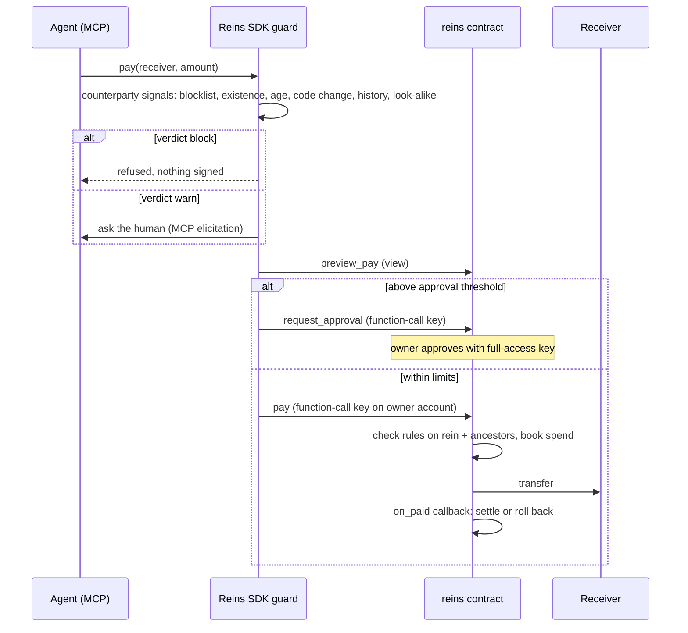

# Architecture

State (all `near_sdk::store::LookupMap`): `reins`, `key_index (owner|pk → rein)`, `owner_reins`, `vaults`, `requests`,
`owner_requests`, `reports`, `allow_overrides`, `pair_count`. Payment history is not stored; every change emits a
NEP-297 event with standard `reins`.
